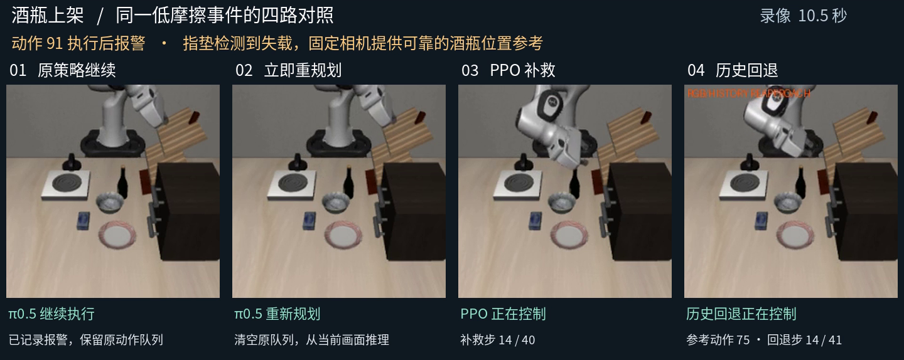

# π0.5 · LIBERO 监督与补救

**从异常检测到恢复动作，再交还 π0.5 重规划**

[观看中文四路演示](docs/2026-11-20/four-way-zh.mp4) · [实验协议与结果](docs/2026-11-20/README.md) · [抽屉自然失败案例](docs/2026-11-20/v0.1-overview.md)

## 最新进展 · 酒瓶上架

在同一个人工低摩擦起点，原策略和直接重规划都未完成任务。示范初始化后经 PPO 训练的补救策略救回了这个起点，更换交接采样种子后仍通过松手后 40 步稳定检查。历史回退在另一个训练侧起点通过同一检查。

| 在线策略 | 正常条件 | 低摩擦条件 |
|:--|--:|--:|
| 原 π0.5 继续 | 5/6 | 3/6 |
| 报警后立即重规划 | 5/6 | 3/6 |
| 程序化历史回退 | 5/6 | 3/6 |
| 纯模仿补救 | 5/6 | 3/6 |
| 奖励塑形 PPO | 5/6 | 3/6 |
| **示范初始化 + PPO** | **5/6** | **4/6** |

主对照共 72 回合，另有 12 回合更换交接采样种子复核，覆盖四个任务、六个起始布局。**PPO 净救回一个独立起点。** 两次放瓶虽然落稳，松手后仍下落约 3.67 cm 和 2.81 cm。

## 系统怎样工作

| 层级 | 实验中的职责 |
|:--|:--|
| **视觉监督** | 固定相机定位目标，连续跟踪；抽屉案例还使用视觉关系判断任务进展。 |
| **执行监督** | 指垫载荷报告失载，视觉给出可靠目标参考。MLP 与 TCN 记录动作一致性旁路分数。 |
| **恢复与交接** | 从历史视觉与位姿构建回退参考，或让 PPO 执行短时连续补救；随后由 π0.5 根据当前观测重规划。 |
| **结果核验** | 对比介入与不介入轨迹，检查松手后是否持续完成，以及松手时物体是否已有支撑。 |

## 复现与研究范围

本仓库保留了抽屉自然失败案例的冻结版本。最新瓶架资料包含在线对照及复现记录。打包重跑在原实例提前一个动作报警，虽然达到任务判据，但未通过松手复核；完整端到端复现有待确认。两种恢复方式的证据来自各自的验证场景。[查看完整实验口径](docs/2026-11-20/README.md)

## 作者

Wang Zihan · Harbin Institute of Technology。引用或展示本项目时请注明作者与仓库来源。
